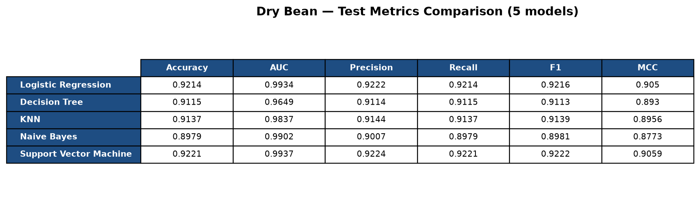
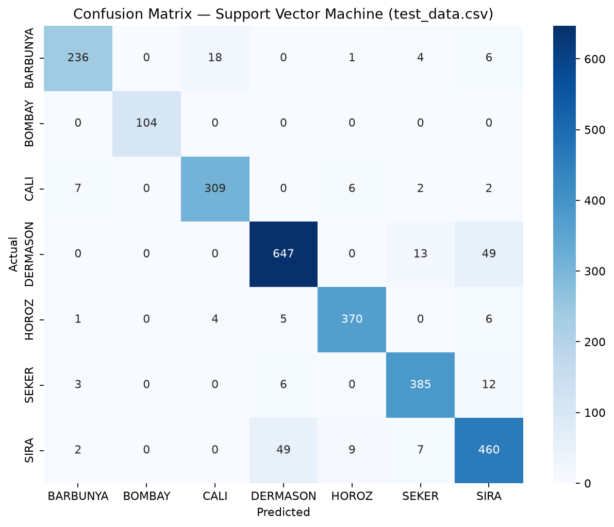
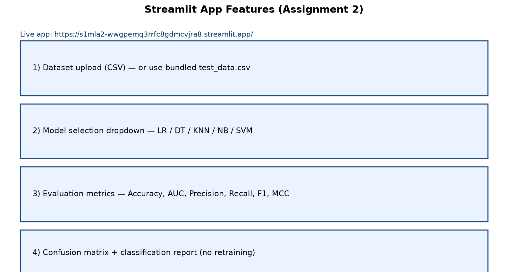

# Machine Learning Assignment 2 — Dry Bean Classification

**Course:** AIML ZG565 / Machine Learning (BITS Pilani WILP)  
**Marks:** 15 · **Deadline:** 08-Nov-2026

---

## Streamlit Application

**Live App:** https://s1mla2-wwgpemq3rrfc8gdmcvjra8.streamlit.app/

**GitHub:** https://github.com/jiteshagg/S1MLA2

The app:
- Uploads a test CSV (or uses bundled `test_data.csv`)
- Lets you select one of **5** saved classifiers
- Displays **Accuracy, AUC, Precision, Recall, F1, MCC**
- Shows a **confusion matrix** and **classification report**
- **Does not retrain** — loads `.joblib` models from `model/`

### App screenshots / evaluation visuals

| View | Preview |
|------|---------|
| Metrics comparison (all 5 models) |  |
| Confusion matrix (SVM on test set) |  |
| App feature checklist |  |

> Tip for evaluators: open the live app → click **Use bundled test_data.csv** → choose **Support Vector Machine**.

---

## a. Problem statement

Build and compare **five supervised classification models** on a public multi-class dataset, report standard evaluation metrics, package the trained models in a **Streamlit** web app (upload test CSV → select model → metrics + confusion matrix), and deploy the app on **Streamlit Community Cloud**. Models are trained once offline; the app **loads saved models** and evaluates on uploaded test data **without retraining**.

---

## b. Dataset description

| Item | Detail |
|------|--------|
| **Name** | UCI Dry Bean Dataset |
| **Source** | [UCI ML Repository — Dry Bean (ID 602)](https://archive.ics.uci.edu/dataset/602/dry+bean+dataset) |
| **Task** | Multi-class classification (7 bean varieties) |
| **Instances** | 13,611 (≥ 500 required) |
| **Features** | 16 numeric morphological features (≥ 12 required) |
| **Target** | `Class` ∈ {SEKER, BARBUNYA, BOMBAY, CALI, DERMASON, HOROZ, SIRA} |
| **Split** | Stratified 80% train / 20% test (`random_state=42`) |

**Feature list:** Area, Perimeter, MajorAxisLength, MinorAxisLength, AspectRation, Eccentricity, ConvexArea, EquivDiameter, Extent, Solidity, roundness, Compactness, ShapeFactor1–4.

### Dataset download

```text
URL: https://archive.ics.uci.edu/static/public/602/dry+bean+dataset.zip
File used: DryBeanDataset/Dry_Bean_Dataset.xlsx
```

The training script downloads/extracts under `data/raw/` (or uses the already extracted Excel) via `train_models.py`. Held-out rows used for the Streamlit demo are saved as `test_data.csv` in this repository.

---

## c. GitHub Repository Link

https://github.com/jiteshagg/S1MLA2

Repository layout:

```text
ml_assignment2/
├── app.py                 # Streamlit frontend
├── train_models.py        # Training script (run once)
├── requirements.txt
├── README.md
├── test_data.csv          # Held-out test set used in experiments
├── test_data_sample.csv   # Smaller sample for quick upload demos
├── model/                 # Saved .joblib models + label encoder
├── artifacts/             # metrics.json, comparison_table.csv, meta.json
├── screenshots/           # README visuals (metrics + confusion matrix)
└── data/raw/              # Original UCI Dry Bean files (local)
```

---

## d. Models used & comparison table

All five models were trained on the **same** Dry Bean training split and evaluated on the **same** held-out test set.

| ML Model Name | Accuracy | AUC | Precision | Recall | F1 | MCC |
|---|---:|---:|---:|---:|---:|---:|
| Logistic Regression | 0.9214 | 0.9934 | 0.9222 | 0.9214 | 0.9216 | 0.9050 |
| Decision Tree | 0.9115 | 0.9649 | 0.9114 | 0.9115 | 0.9113 | 0.8930 |
| KNN | 0.9137 | 0.9837 | 0.9144 | 0.9137 | 0.9139 | 0.8956 |
| Naive Bayes | 0.8979 | 0.9902 | 0.9007 | 0.8979 | 0.8981 | 0.8773 |
| Support Vector Machine | 0.9221 | 0.9937 | 0.9224 | 0.9221 | 0.9222 | 0.9059 |

**Notes on metrics:** Accuracy / Precision / Recall / F1 use **weighted** averaging for multi-class. AUC uses **one-vs-rest, weighted**. MCC is multi-class Matthews correlation.

### Observations on each model

| ML Model Name | Observation about model performance |
|---|---|
| Logistic Regression | Strong overall accuracy (~92.1%) and excellent AUC (~0.993). Linear decision boundaries work well after standardization on these morphological features. |
| Decision Tree | Slightly lower accuracy (~91.2%) and lower AUC (~0.965) than linear/SVM models. Interpretable, but more prone to local overfitting even with depth/leaf limits. |
| KNN | Competitive (~91.4% accuracy). Benefits from StandardScaler; sensitive to local neighbourhood in feature space. |
| Naive Bayes | Lowest accuracy (~89.8%) among the five, but still high AUC (~0.990). Gaussian independence assumption is imperfect for correlated shape features. |
| Support Vector Machine | **Best overall** on this split: highest Accuracy (0.9221), AUC (0.9937), F1 (0.9222), and MCC (0.9059). RBF kernel captures non-linear class boundaries. |
| **Overall winner?** | **Support Vector Machine (RBF)**, with Logistic Regression a very close second. |

---

## How to run locally

```bash
cd ml_assignment2
pip install -r requirements.txt
python train_models.py          # already run once; re-run if needed
streamlit run app.py
```

---

## Academic integrity

Work done for Assignment 2; dataset is public UCI Dry Bean. Training seed fixed (`random_state=42`) for reproducibility.
